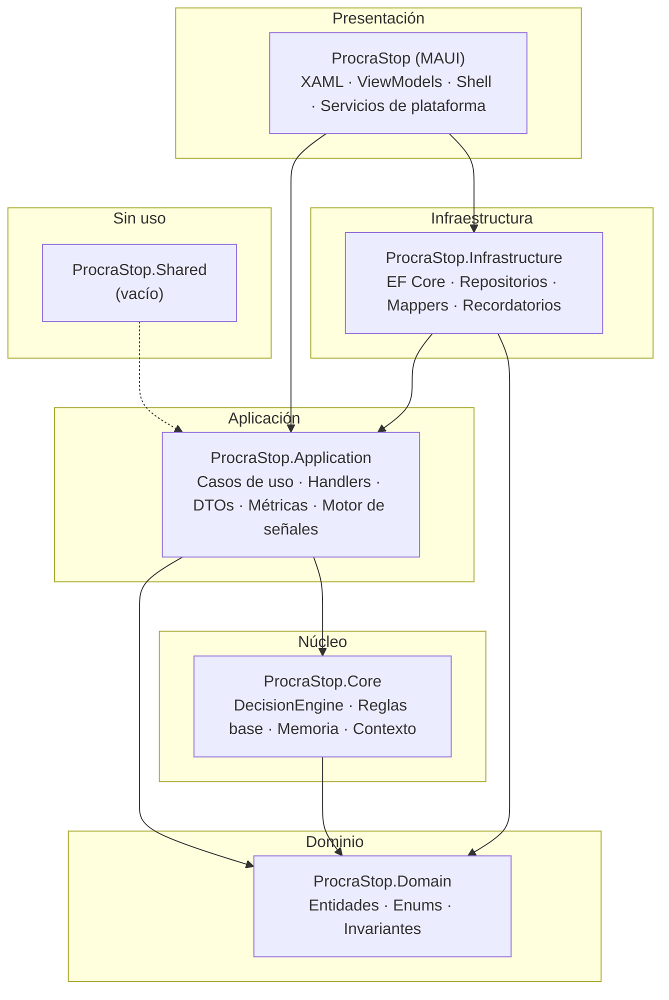
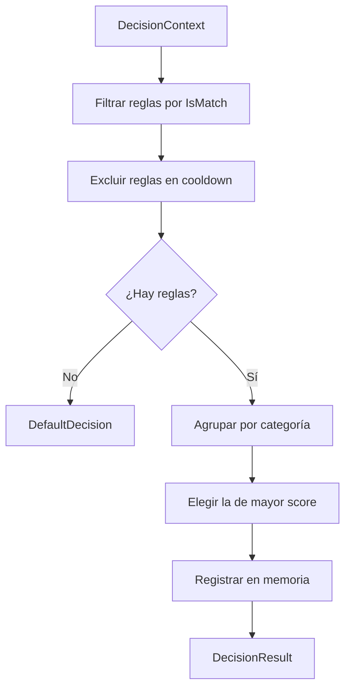
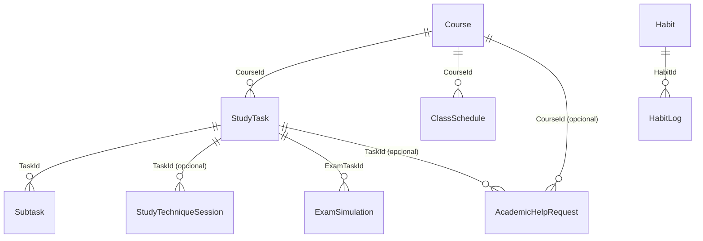

# Arquitectura, UI, UX y patrones — ProcraStop

> Documento de referencia para el desarrollo, la evolución y la migración de ProcraStop a
> **.NET MAUI sobre .NET 11**. Está escrito para tres audiencias simultáneas:
>
> 1. **Desarrollo**: describe capas, patrones, convenciones y recetas reproducibles.
> 2. **Investigación**: conecta cada módulo con la variable dependiente (EPA) sin confundir
>    indicadores conductuales con el instrumento psicométrico.
> 3. **Documentación viva**: sirve de base para crear *skills* de desarrollo asistido.
>
> Versión del documento: **1.0**
> Fecha: **2026-11-10**
> Estado del código: **MVP funcional, 47 casos de prueba, sin commit de los cambios recientes**
> Documento base: [`revision-arquitectura-procrastop.md`](./revision-arquitectura-procrastop.md)

---

## Índice

1. [Ficha y convenciones](#1-ficha-y-convenciones)
2. [Resumen ejecutivo](#2-resumen-ejecutivo)
3. [Contexto metodológico: VI, VD y EPA](#3-contexto-metodológico-vi-vd-y-epa)
4. [Principios de arquitectura](#4-principios-de-arquitectura)
5. [Mapa de capas y dependencias](#5-mapa-de-capas-y-dependencias)
6. [Estructura de la solución](#6-estructura-de-la-solución)
7. [Patrones de arquitectura](#7-patrones-de-arquitectura)
8. [Dominio e invariantes](#8-dominio-e-invariantes)
9. [Modelo de datos](#9-modelo-de-datos)
10. [Persistencia, migraciones y deuda](#10-persistencia-migraciones-y-deuda)
11. [Notificaciones multiplataforma](#11-notificaciones-multiplataforma)
12. [Navegación y arquitectura de información](#12-navegación-y-arquitectura-de-información)
13. [Sistema de diseño y tokens](#13-sistema-de-diseño-y-tokens)
14. [Accesibilidad](#14-accesibilidad)
15. [Estados de interfaz y retroalimentación](#15-estados-de-interfaz-y-retroalimentación)
16. [Onboarding y primera sesión](#16-onboarding-y-primera-sesión)
17. [Matriz de cobertura EPA](#17-matriz-de-cobertura-epa)
18. [Deuda técnica priorizada](#18-deuda-técnica-priorizada)
19. [Migración a .NET 11](#19-migración-a-net-11)
20. [Riesgos](#20-riesgos)
21. [Checklist y criterios de aceptación](#21-checklist-y-criterios-de-aceptación)
22. [Cómo crear skills de desarrollo](#22-cómo-crear-skills-de-desarrollo)
23. [Anexos](#23-anexos)

---

## 1. Ficha y convenciones

### 1.1 Ficha del proyecto

| Campo | Valor |
|---|---|
| Nombre | ProcraStop |
| Tipo | Aplicación móvil multiplataforma (MAUI) con fines académicos y de investigación aplicada |
| Frameworks objetivo | `net10.0-android`, `net10.0-ios`, `net10.0-maccatalyst`, `net10.0-windows10.0.19041.0` |
| Framework destino | `net11.0-*` (ver §19) |
| Lenguaje | C# 13 (implícito en .NET 10), nullable habilitado, `ImplicitUsings` habilitado |
| Patrón | Clean Architecture pragmática + CQRS ligero + motor de reglas |
| Persistencia | EF Core 10 + SQLite (`procra-v3.db`), `IDbContextFactory`, `EnsureCreated` + upgrades manuales |
| UI | XAML + CommunityToolkit.Mvvm + Shell + Syncfusion Toolkit + SkiaSharp |
| Notificaciones | Plugin.LocalNotification + servicio Android con `AlarmManager`/`WorkManager` |
| Pruebas | xUnit, 47 casos (32 `[Fact]` + 3 `[Theory]` con 15 `[InlineData]`) |
| Estado | MVP funcional; cambios recientes sin commit |

### 1.2 Convenciones del documento

- **VI**: variable independiente (la intervención ProcraStop).
- **VD**: variable dependiente (procrastinación académica medida con la EPA).
- **D1**: dimensión *postergación de actividades* de la EPA.
- **D2**: dimensión *autorregulación académica* de la EPA.
- **Señal**: dato conductual que la app registra. **No** es una puntuación de la EPA.
- **Regla**: condición + mensaje + acción sugerida del motor. **No** es IA ni una variable del estudio.
- Rutas de archivo relativas a la raíz del repositorio.
- Los bloques `text` describen estructura; los bloques `csharp` y `xml` son ejemplos normativos.

### 1.3 Regla de oro metodológica

> La app **no mide la EPA**. Registra comportamiento de uso. La EPA se aplica antes y después
> con su redacción, escala y puntuación originales. Cualquier métrica interna (balance, riesgo,
> foco) es un **indicador heurístico de la app**, no un constructo psicológico validado.

Esta regla condiciona la arquitectura: separa **datos de investigación** (EPA, participante,
eventos) de **datos de producto** (tareas, hábitos, sesiones).

---

## 2. Resumen ejecutivo

ProcraStop es un MVP funcional con una base de ingeniería superior a la media de un proyecto de
tesis. La separación en capas es correcta, el motor de reglas es coherente y la cobertura
conductual de la EPA ya es significativa en D1 (postergación) y D2 (autorregulación).

### 2.1 Fortalezas que deben conservarse

1. **Dirección de dependencias limpia** en lo esencial: el dominio no conoce la UI ni la base de datos.
2. **Un solo motor de decisiones** en `ProcraStop.Core`, alimentado por reglas modulares de cada módulo.
3. **Entidades ricas** (`StudyTask`, `Habit`, `AcademicHelpRequest`, `ExamSimulation`) con validaciones e invariantes.
4. **Persistencia adecuada para MAUI** mediante `IDbContextFactory` e índices explícitos.
5. **Métricas EPA ya implementadas**: D1 (primer avance, retraso, inicio al límite, cursos y lecturas) y D2 (ayuda académica, preparación de exámenes, simulacros).
6. **Documentación metodológica** que separa explícitamente uso de la app y medición EPA.

### 2.2 Brechas críticas

| Brecha | Impacto | Prioridad |
|---|---|---|
| Sin consentimiento, código de participante ni exportación | No hay tesis cuantitativa defendible | 🔴 Crítica |
| `EnsureCreated()` sin migraciones versionadas | Pérdida de datos y esquemas divergentes | 🔴 Crítica |
| Sin registro de eventos de uso (`recommendation_shown`, etc.) | No se puede medir adherencia ni evaluar el motor | 🔴 Crítica |
| Navegación con 6 grupos y 12 tabs, etiquetas duplicadas | Curva de aprendizaje y errores de orientación | 🟠 Alta |
| Accesibilidad casi ausente (0 `AutomationProperties`) | Exclusión de usuarios y deuda ética | 🟠 Alta |
| 493 colores hexadecimales y 10 familias tipográficas | Inconsistencia visual y coste de mantenimiento | 🟠 Alta |
| Código muerto y `NotImplementedException` | Riesgo de fallo en runtime y ruido | 🟡 Media |
| Sin CI ni análisis estático | Regresiones silenciosas | 🟡 Media |

### 2.3 Decisión estratégica

La prioridad **no** es añadir pantallas. Es cerrar el circuito de investigación (instrumento,
participante, eventos, exportación), completar la cobertura EPA faltante y después pulir
arquitectura y UX. La migración a .NET 11 es intencional y de bajo riesgo relativo porque el
proyecto es de desarrollo; .NET 10 LTS queda como *fallback*.

---

## 3. Contexto metodológico: VI, VD y EPA

### 3.1 Diseño del estudio

| Elemento | Definición |
|---|---|
| Enfoque | Cuantitativo |
| Diseño | Preexperimental de un solo grupo con pretest/postest |
| Alcance | Descriptivo-aplicativo |
| VI | ProcraStop como intervención (uso de módulos) |
| VD | Procrastinación académica medida con la EPA de 12 ítems |
| Instrumento | Escala de Procrastinación Académica (Domínguez Lara et al., 2014) |
| Duración sugerida | 4–6 semanas |
| Muestra objetivo | ≥30 participantes para inferencia; 10–15 para piloto de usabilidad |

### 3.2 Dimensiones de la EPA

| Dimensión | Ítems | Constructo |
|---|---|---|
| D1 — Postergación de actividades | 1, 6, 7 | Tendencia a dejar tareas para el último momento |
| D2 — Autorregulación académica | 2, 3, 4, 5, 8, 9, 10, 11, 12 | Planificación, constancia, búsqueda de ayuda, preparación |

### 3.3 Qué registra la app y qué no

```text
┌─────────────────────────────────────────────────────────────┐
│  EPA (instrumento externo o modo investigación)              │
│  · 12 ítems Likert 1–5                                       │
│  · Pretest y postest                                        │
│  · Puntuación original, sin reinterpretación                 │
└───────────────────────────┬─────────────────────────────────┘
                            │ se vincula por ParticipantCode
┌───────────────────────────▼─────────────────────────────────┐
│  ProcraStop (intervención)                                   │
│  · Tareas, cursos, hábitos, estrés, técnicas, exámenes       │
│  · Señales conductuales con timestamps                       │
│  · Decisiones mostradas y seguidas (eventos)                 │
│  · Exportación CSV/JSON anonimizada                          │
└─────────────────────────────────────────────────────────────┘
```

**Prohibiciones de diseño:**

- No presentar una métrica interna como “nivel de procrastinación”.
- No usar el motor de reglas para puntuar la VD.
- No introducir una tercera variable de IA.
- No inferir respuestas EPA a partir del comportamiento.

### 3.4 Modo investigación mínimo

El circuito mínimo defendible requiere cuatro piezas:

1. **Consentimiento** versionado con fecha de aceptación.
2. **Código de participante** que etiquete todos los registros.
3. **Eventos de uso** con tipo, entidad, timestamp y versión de app.
4. **Exportación** CSV/JSON con diccionario de datos.

Sin estas cuatro piezas, la app es un producto de productividad, no un instrumento de estudio.

---

## 4. Principios de arquitectura

| Principio | Aplicación concreta |
|---|---|
| **Dependencias hacia dentro** | `Domain` no referencia nada; `Application` referencia `Domain` y `Core`; `Infrastructure` referencia `Application` y `Domain`; la app MAUI compone. |
| **Un motor, muchas reglas** | `DecisionEngine` es único; las reglas viven en `Application/*/Engine*/Rules` y en `Core/Decisions/Rules`. |
| **Composición explícita** | Cada módulo expone `Add<X>Module()` y registra aplicación, infraestructura y presentación. |
| **Contratos pequeños** | DTOs y `record`s para cruzar capas; sin entidades de dominio en la UI. |
| **Persistencia por fábrica** | `IDbContextFactory<AppDbContext>` en lugar de un `DbContext` de larga vida. |
| **Heurísticas etiquetadas** | Todo indicador compuesto se nombra como interno de la app. |
| **Trazabilidad temporal** | Toda señal EPA usa timestamps UTC o fechas locales explícitas y documentadas. |
| **Determinismo** | El motor debe producir la misma decisión ante el mismo contexto y memoria. |
| **Fallar de forma segura** | Los flujos críticos capturan y envuelven errores; nunca tumban la app. |
| **Migración incremental** | Los cambios de esquema se documentan y se aplican con un upgrade idempotente mientras no existan migraciones EF. |

---

## 5. Mapa de capas y dependencias

### 5.1 Diagrama de capas



### 5.2 Reglas de dependencia

| Proyecto | Puede depender de | No puede depender de |
|---|---|---|
| `ProcraStop.Domain` | — | Application, Infrastructure, Core, MAUI |
| `ProcraStop.Core` | Domain | Application, Infrastructure, MAUI |
| `ProcraStop.Application` | Domain, Core | Infrastructure, MAUI |
| `ProcraStop.Infrastructure` | Application, Domain | MAUI |
| `ProcraStop` (MAUI) | Application, Infrastructure | — |
| `ProcraStop.Shared` | — | (sin uso actual) |

### 5.3 Verificación de la regla

Antes de fusionar un cambio, comprobar:

```powershell
# El dominio no debe conocer EF Core ni MAUI
Select-String -Path src\ProcraStop.Domain\**\*.cs -Pattern 'Microsoft\.EntityFrameworkCore|Microsoft\.Maui'
# La aplicación no debe conocer la infraestructura
Select-String -Path src\ProcraStop.Application\**\*.cs -Pattern 'ProcraStop\.Infrastructure'
```

Si aparece una coincidencia, es una violación de capas y debe resolverse con una abstracción
en `Application` e implementación en `Infrastructure`.

---

## 6. Estructura de la solución

### 6.1 Vista de primer nivel

```text
ProcraStopProject/
├─ ProcraStop.sln
├─ global.json
├─ README.md
├─ docs/
│  ├─ alcance-academico.md
│  ├─ revision-arquitectura-procrastop.md
│  └─ arquitectura-procrastop-maui11.md
├─ src/
│  ├─ ProcraStop.Domain/
│  ├─ ProcraStop.Core/
│  ├─ ProcraStop.Application/
│  ├─ ProcraStop.Infrastructure/
│  ├─ ProcraStop/                 # app MAUI
│  └─ ProcraStop.Shared/          # vacío, sin uso
├─ tests/
│  └─ ProcraStop.UnitTests/
└─ artifacts/                     # residuos de pruebas, no versionar
```

### 6.2 Estructura interna por capa

```text
ProcraStop.Domain/
├─ Academic/Entities/            Course
├─ Habits/Entities/              Habit, HabitLog
├─ Stress/Entities/              StressCheckIn
├─ StudyTechniques/Entities/     StudyTechniqueSession, AcademicHelpRequest, ExamSimulation
└─ Tasks/Entities/               StudyTask, Subtask
    Tasks/Enums/                 AcademicActivityType, TaskPriority, TaskItemStatus, TaskEffort, ReminderOffset

ProcraStop.Core/
└─ Decisions/
   ├─ Context/                   DecisionContext
   ├─ DTOs/                      DecisionResult, DecisionType, DecisionCategory
   ├─ Engine/                    DecisionEngine
   ├─ Memory/                    IDecisionMemoryStore, InMemoryDecisionMemoryStore, DecisionMemory
   ├─ Rules/                     IDecisionRule + reglas de comportamiento
   ├─ Mappers/                   TaskSignalExtractor, HabitSignalExtractor, StressSignalExtractor
   └─ DependencyInjection.cs

ProcraStop.Application/
├─ Academic/                     Commands, Queries, DTOs, Facade, DependencyInjection
├─ Dashboard/                    Services, Models, Interfaces
├─ Decisions/                    DecisionContextBuilder
├─ Habits/                       Commands, Queries, EngineHabits, Metrics
├─ Stress/                       Commands, Queries, EngineStress, Metrics
├─ StudyTechniques/              Services (ayuda, exámenes, simulacros), Commands, DTOs
└─ Tasks/                        Commands, Queries, Abstractions, Analytics, EngineTask, Services

ProcraStop.Infrastructure/
├─ DBContext/                    AppDbContext, PersistenceDependencyInjection, interceptor
├─ Academic/                     Persistence, Repositories, Mappers
├─ Dashboard/                    Persistence
├─ Habits/                       Persistence, Repositories, Mappers
├─ Stress/                       Persistence, Repositories, Configs
├─ StudyTechniques/              Persistence, Repositories, Mappers
└─ Tasks/                        Persistence, Repositories, Services (recordatorios)

ProcraStop (MAUI)/
├─ Modules/                      Academic, Dashboard, Habits, Stress, StudyTechniques, Tasks
│  └─ <Módulo>/
│     ├─ <Módulo>Module.cs       composición
│     ├─ DependencyInjection.cs  registro de presentación
│     └─ Presentation/
│        ├─ Views/               XAML + code-behind
│        ├─ ViewModels/
│        ├─ Models/
│        └─ Converters/          (solo donde existan)
├─ Shared/
│  ├─ Services/                  SnackbarService, PendingNotificationService
│  ├─ UI/Components/             CustomSnackbar
│  └─ UI/Layouts/                BasePage
├─ Platforms/Android/Services/   AndroidTaskReminderService
├─ Diagnostics/                  PerformanceTracer
├─ Resources/Styles/             Colors.xaml, AppStyles.xaml
└─ MauiProgram.cs, AppShell.xaml, App.xaml
```

### 6.3 Convenciones de nombres

| Elemento | Convención | Ejemplo |
|---|---|---|
| Entidad | Sustantivo singular | `StudyTask`, `ExamSimulation` |
| Comando | `<Verbo><Entidad>Command` | `CreateTaskCommand` |
| Handler | `<Comando>Handler` | `CreateTaskCommandHandler` |
| Query | `Get<Entidad>Query` | `GetTasksQuery` |
| DTO | `<Entidad>Dto` | `CourseProcrastinationMetricDto` |
| Repositorio | `I<Entidad>Repository` | `IStudyTechniqueSessionRepository` |
| Servicio de aplicación | `<Dominio>Service` | `ExamPreparationService` |
| Regla | `<Comportamiento>Rule` | `AvoidingHardTasksRule` |
| Página | `<Sustantivo>Page` | `TechniqueRecommendationPage` |
| ViewModel | `<Página>ViewModel` | `StudyTechniquesViewModel` |
| Módulo | `Add<Módulo>Module()` | `AddStudyTechniquesModule()` |
| Migración manual | `Upgrade<Descripción>` | `UpgradeCourseAppraisalColumns` |

---

## 7. Patrones de arquitectura

### 7.1 CQRS ligero

**Qué es.** Separación de lecturas (queries) y escrituras (commands) sin event sourcing ni buses
de mensajes. Cada operación tiene su propio objeto y su propio handler.

**Estructura típica:**

```text
Application/Tasks/Commands/CreateTask/
├─ CreateTaskCommand.cs          # datos de entrada
└─ CreateTaskCommandHandler.cs   # orquestación
Application/Tasks/Queries/GetTasks/
├─ GetTasksQuery.cs
└─ GetTasksQueryHandler.cs
```

**Reglas:**

1. Un handler hace **una** cosa y devuelve un resultado explícito (`Guid`, DTO o `void`).
2. El handler no conoce XAML, Shell ni `Page`.
3. Las validaciones de negocio viven en el dominio; el handler solo orquesta.
4. Los errores de infraestructura se envuelven en `InvalidOperationException` con contexto.
5. Las queries no modifican estado.

**Ejemplo normativo — comando:**

```csharp
public sealed class CreateTaskCommandHandler
{
    private readonly ITaskRepository _repository;
    private readonly ITaskReminderService _reminderService;

    public CreateTaskCommandHandler(
        ITaskRepository repository,
        ITaskReminderService reminderService)
    {
        _repository = repository;
        _reminderService = reminderService;
    }

    public async Task<Guid> HandleAsync(
        CreateTaskCommand command,
        CancellationToken cancellationToken = default)
    {
        try
        {
            return await HandleAsyncCore(command, cancellationToken);
        }
        catch (Exception ex)
        {
            throw new InvalidOperationException(
                $"No se pudo crear la tarea: {ex.Message}", ex);
        }
    }
}
```

**Anti-patrón:** handler que actualiza la UI, muestra un snackbar o navega. Eso pertenece al ViewModel.

### 7.2 Repositorios

**Contrato** en `Application/*/Abstractions`; **implementación** en `Infrastructure/*/Repositories`.

```csharp
// Application
public interface ITaskRepository
{
    Task<StudyTask?> GetByIdAsync(Guid id, CancellationToken ct = default);
    Task AddAsync(StudyTask task, CancellationToken ct = default);
    Task UpdateAsync(StudyTask task, CancellationToken ct = default);
    Task<IReadOnlyList<StudyTask>> GetAllAsync(CancellationToken ct = default);
}
```

**Reglas:**

- El repositorio devuelve **entidades de dominio**, no entidades EF.
- El mapeo entidad EF ↔ dominio ocurre en `Infrastructure/*/Mappers`.
- Cada método abre su propio `DbContext` desde la fábrica.
- Los repositorios no contienen reglas de negocio.
- Los índices se declaran en `AppDbContext` y se prueban en `DatabaseIndexPlanTests`.

**Deuda conocida:** no hay `IUnitOfWork`; las operaciones compuestas no son transaccionales.
Ver §18.

### 7.3 Inyección de dependencias modular

**Composición en `MauiProgram.cs`:**

```csharp
builder.Services
    .AddAcademicModule()
    .AddTasksModule()
    .AddHabitsModule()
    .AddStressModule()
    .AddStudyTechniquesModule()
    .AddDashboardModule()
    .AddDecisionEngine();
```

**Cada módulo** registra sus tres capas:

```csharp
public static class AcademicModule
{
    public static IServiceCollection AddAcademicModule(this IServiceCollection services)
    {
        services.AddAcademicApplication();
        services.AddAcademicInfrastructure();
        services.AddAcademicPresentation();
        return services;
    }
}
```

**Ciclos de vida usados:**

| Registro | Ciclo | Motivo |
|---|---|---|
| Handlers | `Transient` | Sin estado entre operaciones |
| Repositorios | `Transient`/`Scoped` | Abren su propio contexto |
| `IDbContextFactory<AppDbContext>` | `Singleton` (fábrica) | Crea contextos cortos |
| ViewModels | `Transient` | Se recrean por navegación |
| Páginas | `Transient` | Se recrean por navegación |
| `PerformanceTracer` | `Singleton` | Métricas globales de arranque |
| `IDecisionMemoryStore` | `Singleton` | Cooldown entre navegaciones |

**Regla:** un módulo nuevo debe registrarse en tres sitios: `Add<X>Application`, `Add<X>Infrastructure`,
`Add<X>Presentation`, y luego en `MauiProgram`.

### 7.4 Motor de reglas

**Ubicación:** `src/ProcraStop.Core/Decisions/Engine/DecisionEngine.cs`.

**Flujo:**



**Contrato de regla:**

```csharp
public interface IDecisionRule
{
    int Priority { get; }
    DecisionCategory Category { get; }
    bool IsMatch(DecisionContext context);
    DecisionResult Evaluate(DecisionContext context);
}
```

**Reglas actuales por módulo:**

| Módulo | Reglas |
|---|---|
| Tareas | `AvoidingHardTasksRule`, `MomentumRule`, `OverdueOverloadRule`, `OverPlanningRule`, `QuickWinRule` |
| Hábitos | `HighDisciplineRule`, `HighFailureRule`, `LowConsistencyRule`, `MomentumGrowthRule`, `RecoveryMomentumRule` |
| Estrés | `HighStressLowRecoveryRule`, `HighStressRisingRule`, `HighStressRule`, `RecoveryNeededRule`, `RecoveryOpportunityRule` |
| Comportamiento transversal | `BurnoutRiskRule`, `BurnoutWithStressRule`, `FakeProductivityRule`, `FakeProductivityWithStressRule`, `LowStressHighEfficiencyRule`, `OverloadWithStressRule`, `StablePerformanceRule` |

**Reglas de diseño del motor:**

1. **Determinismo**: mismo contexto + misma memoria ⇒ misma decisión.
2. **Cooldown**: 30 minutos por regla para no repetir el mismo consejo.
3. **Una principal + secundarias**: no saturar.
4. **Explicación obligatoria**: `Message`, `Reason`, `SuggestedAction`.
5. **Prioridad**: debe usarse como desempate o eliminarse; hoy no se aplica en la selección.
6. **Memoria efímera**: `InMemoryDecisionMemoryStore` se pierde al reiniciar. Documentarlo o persistirlo.
7. **Versionado**: añadir `RulesVersion` cuando el estudio esté en curso.
8. **No medir la VD**: el motor recomienda; no puntúa procrastinación.

**Cómo añadir una regla:**

1. Crear la clase en `Application/<Módulo>/Engine<Módulo>/Rules/`.
2. Implementar `IsMatch` con señales tipadas del contexto.
3. Implementar `Evaluate` devolviendo `DecisionResult` con mensaje, razón y acción.
4. Registrarla en el `DependencyInjection` del módulo como `IDecisionRule`.
5. Añadir prueba unitaria con caso positivo, negativo y límite.
6. Documentarla en la tabla de catálogo.

### 7.5 Proyecciones

**Qué son.** Servicios que combinan señales de varios módulos para producir un modelo de lectura
para la UI (dashboard, analítica, resumen). No persisten estado.

**Ejemplo:** `DashboardProjectionService` combina tareas, hábitos y estrés, construye
`DecisionContext`, evalúa el motor y devuelve un modelo listo para la vista.

**Reglas:**

- Una proyección no escribe en base de datos.
- No contiene lógica de presentación (colores, textos de UI).
- Devuelve DTOs inmutables o `record`s.
- Debe poder probarse sin MAUI.

### 7.6 Fachadas

**Qué son.** Un punto de entrada simplificado para la UI cuando un módulo expone muchas operaciones.

**Estado actual:** `CoursesFacade` funciona; `TasksFacade` lanza `NotImplementedException` y debe
implementarse o eliminarse.

**Regla:** una fachada solo agrupa; no añade lógica de negocio ni duplica handlers.

### 7.7 Mappers

**Ubicación:** `Infrastructure/*/Mappers` (EF ↔ dominio) y `Application/*/Mappers` (dominio ↔ DTO).

**Reglas:**

- Un mapper es estático y sin estado.
- `Rehydrate` reconstruye entidades sin disparar validaciones de creación.
- `Create` aplica invariantes y fechas.
- Nunca exponer entidades EF a la UI.

### 7.8 Servicios de plataforma

**Ubicación:** `src/ProcraStop/Platforms/...` y `src/ProcraStop/Shared/Services`.

**Regla:** la interfaz vive en `Application`; la implementación específica de plataforma vive en la app MAUI.

Ejemplo: `ITaskReminderService` (Application) con `TaskReminderService` (Infrastructure) y
`AndroidTaskReminderService` (MAUI Android).

---

## 8. Dominio e invariantes

### 8.1 `StudyTask`

Entidad central. Campos relevantes para EPA:

| Campo | Tipo | Uso |
|---|---|---|
| `CreatedAtUtc` | `DateTime` | Inicio de la ventana de postergación |
| `PlannedStartDate` | `DateTime?` | Inicio previsto declarado |
| `StartedAtUtc` | `DateTime?` | Primer avance real |
| `DueDate` | `DateTime?` | Fecha límite |
| `CompletedAtUtc` | `DateTime?` | Cierre |
| `PlannedReviewDate` | `DateTime?` | Revisión previa |
| `ReviewedAtUtc` | `DateTime?` | Revisión realizada |
| `ActivityType` | `AcademicActivityType` | `Task`, `Reading`, `Exam`, `Deliverable` |
| `CourseId` | `Guid?` | Vínculo con curso |
| `FirstStep` | `string?` | Activación conductual |
| `IsArchived` | `bool` | Exclusión de métricas activas |

**Invariantes:**

1. `Title` no vacío.
2. `PlannedStartDate` no puede ser posterior a `DueDate`.
3. Un hito no puede planificarse después de la fecha límite.
4. `Deliverable` requiere revisión después de los hitos.
5. `Exam` genera un plan con temas y recuperación antes del examen.
6. `Reading` usa subtareas como capítulos/secciones.
7. Completar una tarea registra `CompletedAtUtc` y cancela recordatorios.
8. Archivar cancela recordatorios y excluye de métricas activas.

### 8.2 `Course`

| Campo | Tipo | Uso |
|---|---|---|
| `InterestLevel` | `int?` (1–5) | Contexto declarado opcional |
| `DifficultyLevel` | `int?` (1–5) | Contexto declarado opcional |
| `AppraisedAtUtc` | `DateTime?` | Momento de la valoración |

**Invariante:** los valores deben estar entre 1 y 5 o ser `null`.

**Principio:** la valoración es contexto, **no** sustituto de la conducta. No se pregunta
“¿te gusta este curso?” como mecanismo principal; se registra de forma opcional e híbrida.

### 8.3 `AcademicHelpRequest`

| Campo | Uso |
|---|---|
| `CreatedAtUtc` | Inicio de la necesidad |
| `RequestedAtUtc` | Momento de pedir ayuda |
| `ResolvedAtUtc` | Momento de resolver |
| `Status` | `Planned`, `Requested`, `Resolved` |
| `Channel` | `CourseMaterial`, `Classmate`, `Teacher` |

**Invariante:** una solicitud requiere pregunta; el flujo es `Planned → Requested → Resolved`.

**Métrica:** consulta estancada si permanece en `Planned` ≥ 2 días.

### 8.4 `ExamSimulation`

| Campo | Regla |
|---|---|
| `ExamTaskId` | Vínculo al examen |
| `Score` | Entero 0–100 |
| `Mistakes` | Texto opcional ≤ 1000 caracteres; espacios → `null` |
| `CreatedAtUtc` | Fecha del intento |

**Invariante:** el puntaje fuera de 0–100 se rechaza.

**Principio:** cada intento se conserva; no se sobrescribe el historial.

### 8.5 `StudyTechniqueSession`

| Campo | Uso |
|---|---|
| `TaskId` | Vínculo opcional al examen |
| `TechniqueCode` | Técnica aplicada |
| `DurationMinutes` | Dedicación |
| `Completed` | Cierre de la sesión |

**Invariante:** `Create` recibe `Guid? taskId` como último parámetro opcional; `Rehydrate` lo recibe
segundo, después del `Id`.

### 8.6 Enumeraciones

```csharp
public enum AcademicActivityType { Task = 0, Reading = 1, Exam = 2, Deliverable = 3 }
public enum TaskPriority { Low = 1, Medium = 2, High = 3 }
public enum TaskItemStatus { Pending = 1, InProgress = 2, Completed = 3 }
public enum TaskEffort { Unknown = 0, Quick = 1, Medium = 2, Heavy = 3 }
public enum ReminderOffset { None = 0, OneMinuteBefore = 1, FiveMinutesBefore = 5, ThirtyMinutesBefore = 30, OneHourBefore = 60, OneDayBefore = 1440 }
```

---

## 9. Modelo de datos

### 9.1 Tablas actuales

| Tabla | Entidad de dominio | Propósito |
|---|---|---|
| `Tasks` | `StudyTask` | Tareas, lecturas, exámenes, entregables |
| `Subtasks` | `Subtask` | Hitos, capítulos, temas |
| `Courses` | `Course` | Cursos con valoración opcional |
| `ClassSchedules` | `ClassSchedule` | Horario semanal |
| `Habits` | `Habit` | Hábitos de estudio |
| `HabitLogs` | `HabitLog` | Registro diario |
| `StressCheckIns` | `StressCheckIn` | Check-in de bienestar |
| `StudyTechniqueSessions` | `StudyTechniqueSession` | Sesiones de estudio |
| `AcademicHelpRequests` | `AcademicHelpRequest` | Consultas académicas |
| `ExamSimulations` | `ExamSimulation` | Historial de simulacros |
| `DecisionMemories` | — | (si se persiste; hoy en RAM) |

### 9.2 Relaciones principales



### 9.3 Índices

Los índices se declaran en `AppDbContext` y se verifican con `DatabaseIndexPlanTests`:

- Tareas por estado y fecha.
- Tareas por curso.
- Subtareas por tarea.
- Sesiones por técnica y por tarea.
- Consultas por estado.
- Simulacros por examen.

**Regla:** toda consulta frecuente nueva debe tener índice y prueba de plan.

### 9.4 Diccionario de datos mínimo

| Columna | Tipo | Nulo | Descripción |
|---|---|---|---|
| `Tasks.Id` | `TEXT` (GUID) | No | Identificador |
| `Tasks.Title` | `TEXT` | No | Título |
| `Tasks.Status` | `INTEGER` | No | 1/2/3 |
| `Tasks.Priority` | `INTEGER` | No | 1/2/3 |
| `Tasks.ActivityType` | `INTEGER` | No | 0–3 |
| `Tasks.CreatedAtUtc` | `TEXT` | No | Alta |
| `Tasks.PlannedStartDate` | `TEXT` | Sí | Inicio previsto |
| `Tasks.StartedAtUtc` | `TEXT` | Sí | Primer avance |
| `Tasks.DueDate` | `TEXT` | Sí | Límite |
| `Tasks.CompletedAtUtc` | `TEXT` | Sí | Cierre |
| `Courses.InterestLevel` | `INTEGER` | Sí | 1–5 |
| `Courses.DifficultyLevel` | `INTEGER` | Sí | 1–5 |
| `ExamSimulations.Score` | `INTEGER` | No | 0–100 |

> El diccionario completo debe generarse desde `AppDbContext` antes de la exportación de datos.

---

## 10. Persistencia, migraciones y deuda

### 10.1 Configuración actual

```csharp
services.AddDbContextFactory<AppDbContext>((provider, options) =>
    options
        .UseSqlite($"Data Source={databasePath}")
        .AddInterceptors(provider.GetRequiredService<DatabasePerformanceInterceptor>()));
```

- Ruta: `procra-v3.db` en el directorio de datos de la app.
- Inicialización: `EnsureCreated()`.
- Upgrades manuales: `PRAGMA table_info` + `ALTER TABLE ADD COLUMN`.
- Tablas nuevas: `CREATE TABLE IF NOT EXISTS` (ejemplo: `ExamSimulations`).
- Interceptor: `DatabasePerformanceInterceptor` mide consultas lentas.

### 10.2 Por qué `EnsureCreated` es deuda

`EnsureCreated()` **no actualiza** una base existente:

- No añade tablas nuevas.
- No añade columnas nuevas.
- No versiona el esquema.
- No permite revertir.

En desarrollo se compensa con upgrades manuales idempotentes. En producción o en un estudio
con datos reales, es insuficiente.

### 10.3 Estrategia de migración recomendada

1. Crear `Migrations/` con `dotnet ef migrations add InitialCreate`.
2. Sustituir `EnsureCreated()` por `Migrate()` en `InitializeDatabase`.
3. Mantener los upgrades manuales como *fallback* para bases ya existentes.
4. Añadir una prueba que abra una base antigua y verifique que migra sin pérdida.
5. Versionar el esquema con `__EFMigrationsHistory`.

### 10.4 Reglas para cambios de esquema

| Situación | Acción |
|---|---|
| Columna nueva nullable | `ALTER TABLE ... ADD COLUMN` idempotente |
| Tabla nueva | `CREATE TABLE IF NOT EXISTS` + `DbSet` + configuración EF |
| Columna obligatoria nueva | Añadir nullable, backfill, luego restricción |
| Renombrado | Crear nueva, copiar, eliminar antigua, migrar |
| Índice nuevo | `CREATE INDEX IF NOT EXISTS` + prueba de plan |

### 10.5 Respaldo y recuperación

- La base local no se respalda automáticamente.
- `android:allowBackup="true"` expone los datos a copias del sistema; para investigación debe
  desactivarse o documentarse.
- Antes de un cambio de esquema, exportar o copiar la base.

---

## 11. Notificaciones multiplataforma

### 11.1 Arquitectura

```text
Application/ITaskReminderService          contrato
        │
        ├─ Infrastructure/Tasks/Services/TaskReminderService      implementación base (Plugin.LocalNotification)
        └─ Platforms/Android/Services/AndroidTaskReminderService  implementación Android (AlarmManager + WorkManager)
```

### 11.2 Dos avisos independientes

| Aviso | Método | Programación | Cancelación |
|---|---|---|---|
| Vencimiento | `ScheduleAsync` | `ReminderDate` | `CancelDueReminderAsync` |
| Inicio previsto | `ScheduleStartReminderAsync` | 08:00 de `PlannedStartDate` o pocos minutos después si ya pasó | `CancelStartReminderAsync` |

**Regla:** una tarea puede tener ambos avisos activos a la vez. Completar, archivar o iniciar
cancela los avisos correspondientes mediante `SyncTaskRemindersAsync`.

### 11.3 Ciclo de vida centralizado

`TaskReminderSchedulingExtensions.SyncTaskRemindersAsync` es el único punto que decide qué
programar o cancelar. Todos los handlers deben usarlo; no duplicar la lógica.

### 11.4 Android

- `AlarmManager` para alarmas exactas.
- `WorkManager` (Xamarin.AndroidX.Work.Runtime) para trabajos diferidos.
- `SharedPreferences` para persistir el estado de los avisos.
- Permisos: `POST_NOTIFICATIONS`, `SCHEDULE_EXACT_ALARM`, `WAKE_LOCK`, `RECEIVE_BOOT_COMPLETED`.
- Deep link: `procrastop://task/{id}`.
- **Deuda:** `MainActivity` no implementa `OnNewIntent`; al tocar la notificación se abre la app
  pero no la tarea.

### 11.5 Reglas de implementación

1. Usar un ID de notificación estable derivado del GUID (no `Guid.GetHashCode()`).
2. Solicitar `POST_NOTIFICATIONS` en runtime en Android 13+ con explicación.
3. No usar `Task.Delay` artificial ni logs con emojis en producción.
4. Verificar permiso antes de mostrar; si falta, registrar el evento y no fallar.
5. Probar el ciclo completo: crear → programar → iniciar → cancelar.

---

## 12. Navegación y arquitectura de información

### 12.1 Estado actual

- `Shell` con `FlyoutBehavior="Flyout"`.
- **6 ítems de flyout**: Tareas, Académico, Inicio, Técnicas de estudio, Hábitos, Configuración.
- **12 tabs** en total.
- Rutas globales registradas en `AppShell.xaml.cs`: `task-detail`, `CreateTaskPage`, `edit-task`, `TechniqueRecommendationPage`, `StudySessionHistoryPage`, `AcademicHelpPage`, `CreateHabitPage`, `habit-track`.
- “Dashboard” dentro de Tareas apunta a `TaskAnalyticsPage`, no al dashboard general.
- “Configuración” es un placeholder “Próximamente”.

### 12.2 Problemas

1. **Etiquetas duplicadas**: “Dashboard” aparece en Tareas y en Hábitos.
2. **Jerarquía confusa**: “Inicio” es un ítem separado de “Tareas”.
3. **Flujos mezclados**: Hábitos y Técnicas pertenecen a autorregulación, pero están separados.
4. **Placeholder**: Configuración no existe.
5. **12 tabs** superan la capacidad de exploración cómoda en móvil.

### 12.3 Arquitectura de información recomendada

```text
Inicio (Hoy)
  · Próxima acción
  · Check-in rápido
  · Próxima clase
  · Racha / progreso

Tareas
  · Hoy / Semana / Todas
  · Calendario
  · Revisión

Horario
  · Horario semanal
  · Asistencia

Estudio
  · Técnicas
  · Pomodoro
  · Exámenes
  · Ayuda académica

Progreso
  · Métricas de tareas
  · Hábitos
  · Bienestar
  · Insights

Perfil / Configuración
  · Participante
  · Privacidad
  · Exportar datos
  · Notificaciones
```

### 12.4 Reglas de navegación

- Máximo **5 destinos** de primer nivel.
- Un destino = una intención del estudiante, no un módulo técnico.
- Las rutas de detalle se registran con `Routing.RegisterRoute`.
- **Nunca registrar con `Routing.RegisterRoute` una página que ya es `ShellContent`/`Tab`/`FlyoutItem`.** Hacerlo crea dos coincidencias y MAUI lanza `Ambiguous routes matched for: ...`, dejando Shell en un estado inconsistente.
- Para ir a un tab o contenido existente de Shell, usar ruta absoluta: `await Shell.Current.GoToAsync("//PomodoroPage")`.
- Para páginas de detalle registradas globalmente, usar ruta relativa: `await Shell.Current.GoToAsync(nameof(CreateTaskPage))`.
- Los parámetros se pasan por `IQueryAttributable` o query properties.
- No anidar más de dos niveles.
- La navegación no debe contener lógica de negocio.

### 12.5 Migración de navegación (pasos)

1. Crear `TodayPage` y mover el dashboard general allí.
2. Renombrar “Dashboard” de Tareas a “Analítica”.
3. Agrupar Técnicas + Pomodoro + Biblioteca + Exámenes + Ayuda en “Estudio”.
4. Mover Hábitos y Bienestar a “Progreso”.
5. Convertir Configuración en página real.
6. Reducir tabs; usar `ShellContent` con rutas y navegación por intención.

### 12.6 Navegación segura y resiliencia de UI

La corrección de rutas de Shell eliminó la ambigüedad, pero una app MAUI
sigue expuesta a caídas por excepciones no observadas. Se añadieron tres
piezas transversales:

| Pieza | Archivo | Responsabilidad |
|---|---|---|
| `AppCrashLogger` | `src/ProcraStop/Diagnostics/AppCrashLogger.cs` | Captura `AppDomain.UnhandledException`, `TaskScheduler.UnobservedTaskException` y, en Android, `AndroidEnvironment.UnhandledExceptionRaiser`. Escribe la traza en `FileSystem.AppDataDirectory/procrastop-crash.log` con rotación a 1 MB. |
| `ShellNavigation` | `src/ProcraStop/Shared/Services/ShellNavigation.cs` | Envuelve `Shell.Current.GoToAsync` con guarda de `null`, `try/catch`, compuerta de serialización y log. Devuelve `bool` en lugar de propagar la excepción. |
| `SafeUi` | `src/ProcraStop/Shared/UI/SafeUi.cs` | Ejecuta trabajo asíncrono disparado desde `async void` y registra cualquier error. |
| `NavigationSmokeTest` | `src/ProcraStop/Diagnostics/NavigationSmokeTest.cs` | Recorre todas las rutas de la app y deja por paso una línea en el log (ruta, página resultante, handler, opacidad). Diagnóstico opt-in. |

Reglas obligatorias:

1. **Ningún `async void` sin protección.** Los `OnAppearing`, eventos de
   messenger y lambdas de `PropertyChanged` deben ejecutarse dentro de
   `SafeUi.RunAsync` o tener `try/catch` con `AppCrashLogger.Log`.
2. **No usar `Shell.Current` directamente en ViewModels.** Usar
   `ShellNavigation.GoToAsync`. Si se necesita un `DisplayAlert`, validar
   `Shell.Current is { } shell` antes de usarlo.
3. **No resolver servicios con `App.Current?.Handler?.MauiContext`.** Un
   `ContentView` instanciado por XAML no recibe DI por constructor: la página
   contenedora debe inyectar su ViewModel y asignarlo a `BindingContext`
   (patrón usado por `DashboardView` → `StressCheckInView`).
4. **Los converters deben tolerar `null`.** Un binding puede entregar `null`
   antes de que el `BindingContext` esté resuelto.
5. **El snackbar no debe bloquear ni sobrevivir a la página.** Se cierra solo,
   serializa peticiones y `BasePage.OnDisappearing` llama a `HideNow()`.
6. **Serializar la navegación.** `ShellNavigation` usa una compuerta global:
   dos navegaciones simultáneas (doble toque) dejan el pipeline de Shell en un
   estado del que no se recupera. Una segunda petición concurrent se descarta
   y queda registrada, no se encola.
7. **No desapilar a ciegas.** `GoBackAsync` verifica que exista una página
   apilada o un modal antes de ejecutar `".."`.

### 12.7 NullReferenceException en bindings compilados: causa raíz y prohibición

**Síntoma.** Al entrar en una pantalla y volver (por ejemplo, Inicio → volver a
Tareas) la app moría con:

```
System.NullReferenceException
  Microsoft.Maui.Controls.BindingBase.CreateTypedBindingFrom_bindingExtension27(...)
  getter: source => (source.OpenDetailCommand, true)
```

**Causa raíz.** Dos hechos combinados:

1. Los bindings dentro de `DataTemplate` usaban
   `Source={RelativeSource AncestorType={x:Type viewModels:MiViewModel}}`.
   MAUI resuelve ese `RelativeSource` **recorriendo el árbol visual** en busca
   de un ancestro cuyo `BindingContext` sea del tipo indicado. Si en ese
   instante el árbol está desconectado, la resolución devuelve `null` y MAUI
   aplica el binding compilado con `source == null` → el getter generado
   (`source.Prop`) lanza `NullReferenceException`.
2. `BasePage` envolvía el contenido de la página en un `AbsoluteLayout` desde
   `OnHandlerChanged`, lo que obligaba a ejecutar `Content = null`. En ese
   instante el contenido quedaba **desconectado de la página**: el
   `BindingContext` heredado pasaba a `null` y los `CollectionView` perdían su
   handler, por lo que MAUI volvía a inflar sus plantillas mientras estaban
   sueltas, con el origen de la binding en `null`.

**Corrección aplicada.**

1. `BasePage` ya **no reparenta el contenido en runtime**. El `CustomSnackbar`
   se declara en el XAML de cada página que lo usa (`TasksPage`,
   `TaskDetailPage`, `HabitListPage`) y se registra con
   `InitializeSnackbar(snackbarService, SnackbarHost)`.
2. Todas las bindings de plantilla que dependían de `RelativeSource` se
   migraron a `x:Reference`, que se resuelve **en tiempo de parseo** y por
   tanto nunca es `null`:

   ```xml
   <!-- Antes (frágil) -->
   Command="{Binding OpenDetailCommand, Source={RelativeSource AncestorType={x:Type viewModels:TasksPageViewModel}}}"

   <!-- Ahora (robusto) -->
   Command="{Binding Path=BindingContext.OpenDetailCommand, Source={x:Reference PageRoot}}"
   ```

   `PageRoot` es el elemento raíz de la página (o la propia página) con
   `x:Name="PageRoot"`.

**Regla para futuros cambios.**

- Dentro de un `DataTemplate`, **nunca** usar `RelativeSource` para alcanzar
  el ViewModel de la página: usar `Source={x:Reference <elemento con nombre>}`.
- **Nunca** reparentar el `Content` de una página en runtime (ni envolverlo en
  otro contenedor). Si se necesita una capa flotante, se declara en el XAML.
- Los `x:Name` se declaran en el elemento **padre** de la plantilla, de modo
  que la referencia existe en el mismo *namescope* del archivo XAML.

**Verificación.** El test de humo comprueba, además de que la navegación llega
a la página esperada, que ningún `TapGestureRecognizer` de las plantillas queda
con `Command == null` (la symptom que indicaba una binding sin resolver):

```powershell
$env:PROCRASTOP_NAV_SMOKE = "1"
.\src\ProcraStop\bin\Debug\net10.0-windows10.0.19041.0\win-x64\ProcraStopApp.exe
# luego leer procrastop-crash.log
```

Salida esperada: `NAV-SMOKE <ruta> -> ok=True page=... match=True handler=True
opacity=1.00` y `gestures <página>: total=N sinComando=0` (los gestos con
evento `Tapped` y el propio tap del snackbar no llevan `Command`).

Diagnóstico en campo:

```powershell
# Ruta del log en Android (ejemplo con adb)
adb shell run-as com.companyname.procrastop cat files/procrastop-crash.log
```

En Windows el archivo está en
`%LOCALAPPDATA%\Packages\<PackageId>\LocalState\procrastop-crash.log` o en la
ruta que devuelva `FileSystem.AppDataDirectory`.

---

## 13. Sistema de diseño y tokens

### 13.1 Estado medido

| Métrica | Valor |
|---|---|
| Archivos XAML | 29 |
| Colores hexadecimales hardcodeados | 493 |
| Atributos `FontFamily` | 282 |
| `SemanticProperties` | 2 |
| `AutomationProperties` | 0 |
| Familias tipográficas distintas | 10 |

Familias detectadas: `InterRegular`, `InterSemiBold`, `LatoBold`, `ManropeRegular`,
`ManropeSemiBold`, `MontserratRegular`, `MontserratSemiBold`, `OpenSansRegular`,
`SegoeSemibold`, `FluentUI` y el typo `Monts erratSemiBold`.

### 13.2 Objetivo

| Ámbito | Objetivo |
|---|---|
| Tipografía | Máximo 2 familias: **Manrope** (títulos) + **Inter** (cuerpo) |
| Color | Tokens semánticos, no hexadecimales por página |
| Espaciado | Escala 4/8/12/16/24/32 |
| Radios | 8/12/18 |
| Iconografía | Fluent UI consistente |
| Temas | Claro/oscuro con contraste verificado |

### 13.3 Tokens propuestos

```xml
<!-- Colors.xaml -->
<Color x:Key="ColorPrimary">#3F75FF</Color>
<Color x:Key="ColorOnPrimary">#FFFFFF</Color>
<Color x:Key="ColorSurface">#F4F6F9</Color>
<Color x:Key="ColorOnSurface">#12141B</Color>
<Color x:Key="ColorSurfaceDark">#0D131C</Color>
<Color x:Key="ColorOnSurfaceDark">#F9FAFB</Color>
<Color x:Key="ColorMuted">#6F7A8F</Color>
<Color x:Key="ColorDanger">#DC2626</Color>
<Color x:Key="ColorWarning">#D97706</Color>
<Color x:Key="ColorSuccess">#16A34A</Color>
```

```xml
<!-- AppStyles.xaml -->
<Style x:Key="TextDisplay" TargetType="Label">
    <Setter Property="FontFamily" Value="ManropeSemiBold" />
    <Setter Property="FontSize" Value="32" />
</Style>
<Style x:Key="TextTitle" TargetType="Label">
    <Setter Property="FontFamily" Value="ManropeSemiBold" />
    <Setter Property="FontSize" Value="23" />
</Style>
<Style x:Key="TextBody" TargetType="Label">
    <Setter Property="FontFamily" Value="InterRegular" />
    <Setter Property="FontSize" Value="15" />
</Style>
<Style x:Key="TextCaption" TargetType="Label">
    <Setter Property="FontFamily" Value="InterRegular" />
    <Setter Property="FontSize" Value="12" />
</Style>
```

### 13.4 Reglas de estilo

1. Ningún color hexadecimal en una página; solo tokens.
2. Ningún `FontFamily` directo en una página; solo estilos por rol.
3. Un estilo por rol semántico, no por página.
4. Eliminar fuentes no usadas de `Resources/Fonts`.
5. Verificar contraste ≥ 4.5:1 para texto normal y ≥ 3:1 para texto grande.
6. Usar `AppThemeBinding` para todo color de superficie y texto.

### 13.5 Deuda visual prioritaria

| Hallazgo | Acción |
|---|---|
| `Monts erratSemiBold` | Corregir o eliminar |
| `InterSemiBold` no registrado en `MauiProgram` | Registrar o sustituir |
| 10 familias | Reducir a 2 |
| 493 hexadecimales | Migrar a tokens |
| 282 `FontFamily` | Migrar a estilos |
| 2 `SemanticProperties` | Añadir descripciones |

---

## 14. Accesibilidad

### 14.1 Estado

- 0 `AutomationProperties` en 29 archivos XAML.
- 2 `SemanticProperties`.
- Gráficos SkiaSharp sin alternativa textual.
- Sin verificación de contraste documentada.
- Sin soporte explícito de escalado de fuente.

### 14.2 Requisitos

| Requisito | Implementación |
|---|---|
| Etiquetas semánticas | `SemanticProperties.Description` en botones e iconos |
| Roles | `SemanticProperties.Hint` en acciones |
| Estado | Anunciar cambios con `SemanticScreenReader` |
| Contraste | Verificar claro/oscuro |
| Tamaño táctil | ≥ 48 dp |
| Escalado | No fijar `FontSize` en píxeles absolutos sin probar |
| Teclado | Orden de tabulación en Windows |
| Gráficos | Texto alternativo o resumen numérico |

### 14.3 Patrón de etiqueta semántica

```xml
<ImageButton Source="icon_add.png"
             AutomationId="AddTaskButton"
             SemanticProperties.Description="Crear tarea"
             SemanticProperties.Hint="Abre el formulario de nueva tarea"
             Clicked="OnAddTaskClicked" />
```

### 14.4 Checklist de accesibilidad por pantalla

- [ ] Todos los botones tienen descripción.
- [ ] Los iconos decorativos están ocultos al lector (`IsInAccessibleTree="False"`).
- [ ] Los estados vacíos se anuncian.
- [ ] Los errores se anuncian y son accionables.
- [ ] El contraste cumple.
- [ ] Los gráficos tienen resumen textual.
- [ ] La pantalla funciona con fuente al 200%.

---

## 15. Estados de interfaz y retroalimentación

### 15.1 Estados canónicos

Toda pantalla con datos debe cubrir:

| Estado | Comportamiento | Componente |
|---|---|---|
| **Cargando** | Skeleton o spinner | `ActivityIndicator` / shimmer |
| **Vacío** | Mensaje + acción primaria | `EmptyView` |
| **Error** | Mensaje + reintentar | `Border` de error + botón |
| **Offline** | Aviso persistente | Banner superior |
| **Parcial** | Datos con aviso de desactualización | Banner |
| **Éxito** | Snackbar breve | `CustomSnackbar` |

### 15.2 Patrón `BasePage`

`src/ProcraStop/Shared/UI/Layouts/BasePage.cs` centraliza el snackbar y el ciclo de vida.
Las páginas deben heredar de `BasePage` cuando necesiten retroalimentación uniforme.

### 15.3 Reglas de retroalimentación

1. Un snackbar por acción; no encadenar.
2. Los errores deben decir **qué pasó** y **qué hacer**.
3. No usar `Console.WriteLine` para feedback de usuario.
4. El estado vacío debe ofrecer la acción que lo resuelve.
5. El estado de carga no debe bloquear la navegación.

### 15.4 Deuda actual

- `EmptyView` presente en varias listas, no en todas.
- Sin estados de error consistentes.
- Sin indicador de offline.
- Sin skeletons; algunas pantallas muestran vacío mientras cargan.
- `Console.WriteLine` abundante en lugar de `ILogger`.

---

## 16. Onboarding y primera sesión

### 16.1 Objetivo

Que el estudiante entienda qué es ProcraStop, qué no es, qué permisos necesita y cuál es su
primer paso concreto en menos de 3 minutos.

### 16.2 Flujo propuesto

```text
1. Bienvenida
   · Qué es ProcraStop
   · Qué no es (no es terapia, no es diagnóstico)
2. Consentimiento informado (si aplica)
   · Versión, fecha, aceptación
3. Código de participante
   · Anónimo, vinculable a pretest/postest
4. Permisos
   · Notificaciones con explicación
   · Alarmas exactas (Android)
5. Configuración mínima
   · 1 curso
   · 1 bloque de horario
6. Primera tarea
   · Título + primer paso pequeño + fecha límite
7. Hoy
   · Una acción concreta
```

### 16.3 Reglas de onboarding

- No pedir más de lo necesario para la primera acción.
- Explicar cada permiso antes de solicitarlo.
- Permitir omitir la valoración de cursos.
- Guardar el progreso del onboarding.
- No bloquear la app si el usuario rechaza notificaciones.

### 16.4 Métricas de onboarding

- Tiempo hasta la primera tarea creada.
- Tareas creadas en la primera sesión.
- Abandono por paso.
- Permisos concedidos/rechazados.

---

## 17. Matriz de cobertura EPA

Leyenda: ✅ cubierto · 🟡 parcial · 🔴 ausente.

### 17.1 D1 — Postergación de actividades

| Indicador | Módulo | Estado | Dato / métrica | Qué falta |
|---|---|---|---|---|
| Postergación al último momento | Tareas + Analítica + Motor | ✅ | `CreatedAtUtc`, `PlannedStartDate`, `StartedAtUtc`, `DueDate`; tiempo hasta primer avance, retraso vs inicio previsto, % inicio puntual, % inicio al límite | Registrar motivo de postergación |
| Cursos no preferidos | Tareas + Cursos + Analítica | ✅/🟡 | `CourseId`, `InterestLevel`, `DifficultyLevel`, `AppraisedAtUtc`; métricas por curso con mínimo 3 inicios | Regla del motor que compare cursos |
| Lecturas no preferidas | `ActivityType.Reading` + subtareas | 🟡 | Capítulos/secciones como subtareas; primer capítulo = primer avance; métricas por curso | Páginas/minutos por sesión y comprensión |

### 17.2 D2 — Autorregulación académica

| Indicador | Módulo | Estado | Dato / métrica | Qué falta |
|---|---|---|---|---|
| Preparación de exámenes | Exámenes + Estudio | ✅ | `StudyTechniqueSession.TaskId`, temas `Estudiar: X`, cobertura, anticipación, simulacros | Repaso espaciado; cobertura por subtema |
| Búsqueda de ayuda | Ayuda académica | ✅ | `CreatedAtUtc`, `RequestedAtUtc`, `ResolvedAtUtc`; tiempo hasta pedir/resolver; estancadas ≥ 2 días | Notificación de seguimiento; vínculo con recomendación |
| Asistencia a clases | Horario | 🔴 | `ClassSchedule.ReminderMinutesBefore` no se usa | Registro presente/ausente/tarde/justificado |
| Tareas oportunas | Tareas + Analítica | 🟡 | `Completed`, `Overdue`, tasa de finalización | Métrica on-time explícita y tendencia |
| Hábitos de estudio | Hábitos | ✅ | `HabitLog`, consistencia, racha, ranking | Plantillas y vínculo con metas |
| Dedicación al estudio | Pomodoro + Sesiones | 🟡 | `StudyTechniqueSession` | Pomodoro persistente; metas semanales |
| Motivación | — | 🔴 | — | Metas, insignias, rachas canjeables |
| Entrega anticipada | Tareas + Revisión | 🟡 | `CompletedAtUtc < DueDate` | `SubmittedAtUtc` y clasificación |
| Revisión de tareas | Revisión | 🟡 | Solo `Deliverable` exige revisión | Checklist y repaso espaciado |

### 17.3 Prioridad de módulos faltantes

1. Asistencia a clases (dato ya modelado).
2. Motivación y recompensas.
3. Regla de evitación por curso.
4. Flujo de lectura ampliado.
5. Revisión/repaso espaciado.
6. Pomodoro persistente + metas.
7. Cobertura por subtema más fina.

### 17.4 Fórmulas de referencia

| Métrica | Fórmula |
|---|---|
| Tiempo hasta primer avance | `StartedAtUtc - CreatedAtUtc` |
| Retraso vs inicio previsto | `StartedAtUtc.Date - PlannedStartDate.Date` |
| % inicio puntual | `inicios con StartedAtUtc.Date <= PlannedStartDate.Date / inicios medidos` |
| % inicio al límite | `inicios en últimas 24 h antes de DueDate / inicios con DueDate` |
| Tiempo hasta pedir ayuda | `RequestedAtUtc - CreatedAtUtc` |
| Tiempo hasta resolver | `ResolvedAtUtc - RequestedAtUtc` |
| Cobertura de temas | `temas con al menos una sesión / total de temas` |
| Anticipación de examen | `ExamDueDate.Date - SessionDate.Date` (días) |
| Mejora de simulacro | `último puntaje - primer puntaje` |

---

## 18. Deuda técnica priorizada

### 18.1 Crítica

| Hallazgo | Evidencia | Riesgo | Acción |
|---|---|---|---|
| Sin consentimiento ni participante | — | Estudio no defendible | Implementar `ResearchParticipant` |
| Sin exportación | — | Datos atrapados en SQLite | CSV/JSON + diccionario |
| Sin eventos de uso | — | No se mide adherencia | `AppEvent` + `recommendation_shown/followed` |
| `EnsureCreated()` | `PersistenceDependencyInjection.cs` | Pérdida de datos | Migraciones EF |
| `SQLitePCLRaw.lib.e_sqlite3` 2.1.11 (transitivo de `bundle_green` 2.1.10) vulnerable | `NU1903` | Seguridad | Actualizar |

### 18.2 Alta

| Hallazgo | Evidencia | Acción |
|---|---|---|
| `TasksFacade` con `NotImplementedException` | `Application/Tasks/Facade/TasksFacade.cs` | Implementar o eliminar |
| `ProgressToWidthConverter.ConvertBack` lanza | `Modules/Dashboard/Presentation/Converters` | Implementar o eliminar |
| `GetFocusTasksHandler` comentado | `Application/Tasks/Queries/GetFocusTasks` | Eliminar o implementar |
| `UnitTest1` vacío | `tests/.../UnitTest1.cs` | Eliminar |
| Dos implementaciones de recordatorios | Infrastructure + Android | Documentar estrategia |
| `Console.WriteLine` en producción | 20+ apariciones | `ILogger<T>` |
| Sin validación de comandos | Handlers | `FluentValidation` o `Result<T>` |
| Sin Unit of Work | Repositorios | Transacciones explícitas |
| Recordatorio fuera de transacción | `CreateTaskCommandHandler` | Outbox o reintento |
| Motor ignora `Priority` | `DecisionEngine` | Usar como desempate |
| Memoria del motor en RAM | `InMemoryDecisionMemoryStore` | Persistir o documentar |
| `GetRecentAsync(int days)` engañoso | `StudyDashboardService` | Renombrar |
| `CalculateHelpNeedScore(3,3,...)` | `StudyDashboardService` | Usar check-in real |
| `Guid.GetHashCode()` en notificaciones | `TaskReminderService` | Hash determinista |
| `Task.Delay(500)` y emojis | `TaskReminderService` | Eliminar |

### 18.3 Media

| Hallazgo | Acción |
|---|---|
| `ProcraStop.Shared` vacío | Eliminar o poblar |
| Sin `.editorconfig` | Añadir |
| Sin `Directory.Build.props` | Centralizar versiones |
| Sin CI | Añadir workflow |
| Sin pruebas del motor | Añadir |
| Sin pruebas de ViewModels críticos | Añadir |
| Sin ADRs | Crear `docs/adr/` |
| `artifacts/tmp-sdkpin` | Eliminar |
| `ProcraStop.csproj` con `Folder Include` vacío | Limpiar |

### 18.4 Orden recomendado

```text
1. Instrumento + participante + eventos + exportación
2. Migraciones EF + actualización de SQLitePCLRaw
3. Cobertura EPA faltante (asistencia, motivación, lectura, revisión)
4. Limpieza de código muerto + ILogger + validación
5. Navegación + onboarding + sistema de diseño + accesibilidad
6. Pruebas del motor y CI
7. Documentación y usabilidad
```

---

## 19. Migración a .NET 11

### 19.1 Contexto

- .NET 10 es LTS; .NET 11 ya está disponible con mejoras para MAUI.
- El proyecto es de prueba/desarrollo, por lo que migrar es intencional y asumible.
- .NET 10 LTS queda como *fallback* si aparece un bloqueo.

### 19.2 Cambios relevantes de .NET 11 para MAUI

| Cambio | Impacto en ProcraStop |
|---|---|
| CoreCLR por defecto en MAUI | Mejor rendimiento; Mono sigue disponible |
| NativeAOT opt-in (Android experimental) | Evaluar solo si se necesita arranque rápido |
| MAUI como workload + paquetes NuGet | Permite fijar versiones por proyecto |
| Material 3 en handlers Android | Revisar `Entry`, `DatePicker`, `Slider`, `ImageButton` |
| `LongPressGestureRecognizer` | Útil para acciones rápidas en listas |
| Shell route templates | Simplifica rutas parametrizadas |
| XAML Incremental Hot Reload | Mejora el ciclo de desarrollo |
| `CollectionView2` en Windows | Evaluar para listas grandes |
| Shell basado en handlers en Android | Revisar navegación y deep links |
| `Microsoft.Maui.Controls.Compatibility` eliminado | Verificar que no se use |
| HybridWebView AOT-safe | No aplica hoy |
| Passkeys | No aplica hoy |
| `Window.StatusBarTheme` | Mejora el control de barra de estado |
| `dotnet watch` con selección de dispositivo | Mejora el flujo de desarrollo |

### 19.3 Plan de migración

**Paso 0 — Preparación**

- [ ] Confirmar que los cambios actuales están commiteados o respaldados.
- [ ] Documentar la versión de SDK y workloads actuales.
- [ ] Ejecutar `dotnet test` y guardar la línea base (47/47).
- [ ] Ejecutar build Android y guardar advertencias.

**Paso 1 — Toolchain**

- [ ] Instalar SDK .NET 11 y workloads MAUI completos.
- [ ] Ejecutar `dotnet workload restore` / `repair`.
- [ ] Verificar `dotnet workload list` sin workloads faltantes.
- [ ] Actualizar o eliminar `global.json` según la estrategia.

**Paso 2 — Target frameworks**

```xml
<TargetFrameworks>net11.0-android</TargetFrameworks>
<TargetFrameworks Condition="!$([MSBuild]::IsOSPlatform('linux'))">$(TargetFrameworks);net11.0-ios;net11.0-maccatalyst</TargetFrameworks>
<TargetFrameworks Condition="$([MSBuild]::IsOSPlatform('windows'))">$(TargetFrameworks);net11.0-windows10.0.19041.0</TargetFrameworks>
```

**Paso 3 — Paquetes**

- [ ] Actualizar `Microsoft.Maui.Controls` a la versión 11.
- [ ] Revisar `CommunityToolkit.Maui`, `Syncfusion.Maui.Toolkit`, `SkiaSharp`, `Plugin.LocalNotification`.
- [ ] Actualizar `SQLitePCLRaw` por la vulnerabilidad.
- [ ] Ejecutar `dotnet list package --vulnerable`.

**Paso 4 — Código**

- [ ] Revisar APIs obsoletas.
- [ ] Verificar `MauiXamlInflator=SourceGen` con XAML estricto.
- [ ] Revisar `UseMaterial3` y controles Android.
- [ ] Implementar `OnNewIntent` para deep links.
- [ ] Verificar `Shell` y rutas.

**Paso 5 — Validación**

- [ ] `dotnet build` Android sin errores.
- [ ] `dotnet test` 47/47.
- [ ] Prueba manual de: crear tarea, recordatorio de vencimiento, aviso de inicio, curso, ayuda académica, examen, simulacro, dashboard.
- [ ] Prueba de tema claro/oscuro.
- [ ] Prueba de notificación con app cerrada.

### 19.4 Riesgos de migración

| Riesgo | Mitigación |
|---|---|
| Workloads incompletos | `dotnet workload restore/repair` con permisos de administrador |
| Paquetes sin versión 11 | Aislar en un commit y probar por partes |
| Cambios de Material 3 | Revisar capturas antes/después |
| `global.json` pin | Documentar y actualizar a 11 o eliminar |
| NativeAOT | No adoptar en la primera iteración |

### 19.5 Estado actual del toolchain

- SDKs instalados: `10.0.302`, `10.0.401`, `11.0.100`.
- `dotnet --version` resuelve `10.0.401` por `global.json`.
- Workload set `10.0.404`; instalados `android`, `ios`, `maccatalyst`, `maui-windows`.
- Falta `maui-android`.
- Con SDK 11 aparece `NETSDK1147: wasm-tools-net10`.
- Con SDK 10 falta `maui-android` y hay error de workload set.

**Conclusión:** el bloqueo es de toolchain, no de código. Resolver workloads antes de cambiar TFMs.

### 19.6 Estrategia de convivencia .NET 10 / .NET 11

1. Mantener una rama `net10` estable.
2. Crear una rama `net11` para la migración.
3. No mezclar cambios de features con cambios de framework.
4. Comparar resultados de pruebas y capturas.
5. Si .NET 11 bloquea, volver a `net10` sin perder trabajo.

---

## 20. Riesgos

### 20.1 Riesgos técnicos

| Riesgo | Probabilidad | Impacto | Mitigación |
|---|---|---|---|
| Pérdida de datos por `EnsureCreated` | Alta | Alto | Migraciones + respaldo |
| Workloads incompletos | Alta | Alto | Restaurar antes de migrar |
| Regresiones sin CI | Alta | Medio | Workflow de build/test |
| Motor no determinista | Media | Alto | Pruebas y prioridad |
| Notificaciones no entregadas | Media | Medio | Pruebas por fabricante |
| Deep link roto | Alta | Bajo | Implementar `OnNewIntent` |
| Fuentes no registradas | Media | Bajo | Revisar `MauiProgram` |

### 20.2 Riesgos metodológicos

| Riesgo | Impacto | Mitigación |
|---|---|---|
| Confundir métricas internas con EPA | Alto | Etiquetado explícito |
| Cambiar reglas a mitad del estudio | Alto | `RulesVersion` |
| Sin eventos de recomendación | Alto | Registrar `shown/followed` |
| Muestra insuficiente | Medio | Reportar como piloto |
| Sesgo por onboarding deficiente | Medio | Onboarding + métricas |

### 20.3 Riesgos de UX

| Riesgo | Impacto | Mitigación |
|---|---|---|
| Navegación confusa | Alto | Reorganizar a 5 destinos |
| Accesibilidad ausente | Alto | Checklist por pantalla |
| Inconsistencia visual | Medio | Tokens y estilos |
| Estados vacíos pobres | Medio | Patrón canónico |

---

## 21. Checklist y criterios de aceptación

### 21.1 Checklist de arquitectura

- [ ] `Domain` no referencia EF Core ni MAUI.
- [ ] `Application` no referencia `Infrastructure`.
- [ ] Cada módulo expone `Add<X>Module()`.
- [ ] Cada handler tiene una responsabilidad.
- [ ] Cada entidad tiene invariantes probadas.
- [ ] Cada consulta frecuente tiene índice y prueba.
- [ ] Cada regla del motor tiene prueba.
- [ ] No hay `NotImplementedException` en rutas activas.
- [ ] No hay `Console.WriteLine` en producción.
- [ ] La memoria del motor está documentada.

### 21.2 Checklist de UI/UX

- [ ] Máximo 5 destinos de primer nivel.
- [ ] Sin etiquetas duplicadas.
- [ ] Toda pantalla cubre carga/vacío/error.
- [ ] Todos los botones tienen descripción semántica.
- [ ] Contraste verificado en claro/oscuro.
- [ ] Tokens de color y tipografía.
- [ ] Estados vacíos con acción.
- [ ] Snackbar uniforme.
- [ ] Deep link de notificación funciona.
- [ ] Onboarding completo.

### 21.3 Checklist de investigación

- [ ] Consentimiento versionado.
- [ ] Código de participante.
- [ ] Pretest y postest registrados.
- [ ] Eventos de uso.
- [ ] Exportación CSV/JSON.
- [ ] Diccionario de datos.
- [ ] Borrado de datos.
- [ ] Anonimización.
- [ ] Protocolo de investigación.
- [ ] Aprobación ética.

### 21.4 Criterios de aceptación de una feature

Una feature se considera terminada cuando:

1. Tiene comando/query y handler.
2. Tiene validaciones de dominio.
3. Tiene persistencia y mapeo.
4. Tiene UI con estados.
5. Tiene pruebas (caso feliz, error, límite).
6. Tiene documentación de la regla o métrica.
7. No rompe recordatorios ni aviso de inicio.
8. Pasa `dotnet build` y `dotnet test`.

### 21.5 Criterios de aceptación de la migración .NET 11

- [ ] Build Android sin errores.
- [ ] 47/47 pruebas.
- [ ] Sin workloads faltantes.
- [ ] Notificaciones de vencimiento e inicio funcionando.
- [ ] Tema claro/oscuro correcto.
- [ ] Navegación y deep links correctos.
- [ ] Sin regresiones visuales en pantallas clave.

---

## 22. Cómo crear skills de desarrollo

Esta sección convierte el documento en un **catálogo de skills** reutilizables por agentes de
desarrollo. Una skill es una unidad de conocimiento operativo: cuándo usarla, qué reglas seguir,
qué archivos tocar y cómo verificar el resultado.

### 22.1 Formato de una skill

Cada skill vive en su propia carpeta con un `SKILL.md`:

```text
skills/
└─ procrastop-add-command/
   ├─ SKILL.md
   ├─ examples/
   │  ├─ Command.cs
   │  └─ Handler.cs
   └─ checklist.md
```

**Frontmatter obligatorio:**

```markdown
---
name: procrastop-add-command
description: Añade un comando CQRS a un módulo de ProcraStop con handler, DTO,
  registro de DI, persistencia y pruebas. Úsala cuando se pida una nueva acción
  de escritura (crear, actualizar, completar, archivar).
---
```

**Cuerpo obligatorio:**

1. **Cuándo usar** la skill.
2. **Precondiciones** (archivos y capas existentes).
3. **Pasos** ordenados y numerados.
4. **Archivos a crear/modificar**.
5. **Reglas de negocio** que no se pueden romper.
6. **Verificación** (build, tests, checklist).
7. **Anti-patrones**.
8. **Ejemplo mínimo**.

### 22.2 Catálogo propuesto

| Skill | Propósito | Cuándo usarla |
|---|---|---|
| `procrastop-domain-entity` | Crear o modificar una entidad rica | Nueva entidad o invariante |
| `procrastop-add-command` | Añadir comando + handler | Acción de escritura |
| `procrastop-add-query` | Añadir query + handler + DTO | Lectura nueva |
| `procrastop-ef-sqlite` | Añadir tabla/columna/índice | Cambio de esquema |
| `procrastop-decision-rule` | Añadir regla al motor | Nuevo consejo |
| `procrastop-epa-metric` | Añadir métrica conductual | Nuevo indicador EPA |
| `procrastop-maui-page` | Crear página + ViewModel + DI | Nueva pantalla |
| `procrastop-notifications` | Programar/cancelar avisos | Recordatorios |
| `procrastop-testing` | Añadir pruebas xUnit | Cobertura |
| `procrastop-migration-net11` | Migrar TFM y paquetes | Actualización de framework |

### 22.3 Plantilla de skill

````markdown
---
name: procrastop-<acción>
description: <qué hace> Úsala cuando <disparador>.
---

# <Título>

## Cuándo usar
- ...

## Precondiciones
- ...

## Pasos
1. ...
2. ...

## Archivos
| Acción | Ruta |
|---|---|
| Crear | ... |
| Modificar | ... |

## Reglas que no se pueden romper
- No romper el recordatorio de vencimiento.
- No romper el aviso de inicio previsto.
- No introducir IA ni una tercera variable.
- No presentar métricas internas como EPA.

## Verificación
```powershell
dotnet build src/ProcraStop/ProcraStopApp.csproj -f net10.0-android
dotnet test tests/ProcraStop.UnitTests/ProcraStop.UnitTests.csproj
```

## Anti-patrones
- ...

## Ejemplo
```csharp
// ...
```
````

### 22.4 Receta: añadir un comando

**Skill:** `procrastop-add-command`

1. Crear `Application/<Módulo>/Commands/<Acción>/<Acción>Command.cs`.
2. Crear `<Acción>CommandHandler.cs` con una dependencia por responsabilidad.
3. Validar en el dominio, no en el handler.
4. Persistir con el repositorio.
5. Sincronizar recordatorios con `SyncTaskRemindersAsync` si aplica.
6. Registrar el handler en `DependencyInjection`.
7. Exponer el método en la fachada si la UI la usa.
8. Añadir prueba de caso feliz, error y límite.

**Verificación:** build + test + prueba manual del flujo.

### 22.5 Receta: añadir una regla

**Skill:** `procrastop-decision-rule`

1. Identificar la señal en `DecisionContext`.
2. Crear la regla en `Application/<Módulo>/Engine<Módulo>/Rules/`.
3. Implementar `IsMatch` con umbrales explícitos.
4. Implementar `Evaluate` con `Message`, `Reason`, `SuggestedAction`.
5. Asignar `Category` y `Priority`.
6. Registrar como `IDecisionRule`.
7. Añadir pruebas: positiva, negativa, límite y cooldown.
8. Documentar en el catálogo de reglas.

**Regla:** una regla no debe depender de otra; el motor las combina.

### 22.6 Receta: añadir una métrica EPA

**Skill:** `procrastop-epa-metric`

1. Verificar que existe el timestamp necesario.
2. Si falta, añadir columna nullable + upgrade.
3. Calcular la métrica en un servicio de aplicación.
4. Exponerla en un DTO.
5. Mostrarla en la pantalla de analítica.
6. Añadir prueba con fechas controladas.
7. Documentar fórmula y limitaciones.
8. Etiquetarla como indicador conductual, no EPA.

**Regla:** no usar `DateTime.UtcNow` en pruebas; usar `Rehydrate` con fechas fijas.

### 22.7 Receta: añadir una página

**Skill:** `procrastop-maui-page`

1. Crear `Presentation/Views/<Nombre>Page.xaml` y code-behind.
2. Crear `Presentation/ViewModels/<Nombre>ViewModel.cs`.
3. Registrar ambos como `Transient`.
4. Registrar la ruta en `AppShell.xaml.cs` si es detalle.
5. Añadir `x:DataType` para bindings compilados.
6. Cubrir estados carga/vacío/error.
7. Añadir `SemanticProperties`.
8. Verificar tema claro/oscuro.

### 22.8 Receta: cambiar el esquema

**Skill:** `procrastop-ef-sqlite`

1. Actualizar la entidad EF y `AppDbContext`.
2. Añadir índice si hay consulta frecuente.
3. Crear upgrade idempotente en `PersistenceDependencyInjection`.
4. Añadir prueba de inicialización doble.
5. Añadir prueba de plan de índice.
6. Documentar en el diccionario de datos.
7. Verificar que `EnsureCreated` no rompe bases existentes.

### 22.9 Convenciones para skills

| Convención | Regla |
|---|---|
| Idioma | Español para documentación; inglés para código |
| Rutas | Relativas a la raíz del repositorio |
| Comandos | PowerShell en Windows |
| Ejemplos | Código real, no pseudocódigo |
| Reglas | Explícitas y verificables |
| Anti-patrones | Al menos 3 por skill |
| Verificación | Build + test + checklist |

### 22.10 Anti-patrones de skills

1. **Skill demasiado amplia**: “haz una feature completa” no es una skill; divídela.
2. **Skill sin verificación**: si no se puede comprobar, no es operativa.
3. **Skill que contradice el dominio**: no proponer `DateTime.Now` donde se usa UTC.
4. **Skill que rompe notificaciones**: siempre sincronizar avisos.
5. **Skill que introduce IA**: prohibido por diseño metodológico.
6. **Skill que mezcla capas**: no poner EF en `Application`.
7. **Skill que ignora la accesibilidad**: toda página debe tener etiquetas.
8. **Skill que cambia el esquema sin upgrade**: prohibido.

### 22.11 Cómo validar una skill

- [ ] Tiene frontmatter válido.
- [ ] Tiene “cuándo usar”.
- [ ] Tiene pasos numerados.
- [ ] Tiene archivos concretos.
- [ ] Tiene reglas que no se rompen.
- [ ] Tiene verificación ejecutable.
- [ ] Tiene anti-patrones.
- [ ] Tiene ejemplo real.
- [ ] No contradice este documento.

---

## 23. Anexos

### 23.1 Archivos clave

| Área | Archivo |
|---|---|
| Composición | `src/ProcraStop/MauiProgram.cs` |
| Navegación | `src/ProcraStop/AppShell.xaml`, `AppShell.xaml.cs` |
| Motor | `src/ProcraStop.Core/Decisions/Engine/DecisionEngine.cs` |
| Contexto | `src/ProcraStop.Application/Decisions/DecisionContextBuilder.cs` |
| Dominio tareas | `src/ProcraStop.Domain/Tasks/Entities/StudyTask.cs` |
| Dominio cursos | `src/ProcraStop.Domain/Academic/Entities/Course.cs` |
| Analítica | `src/ProcraStop.Application/Tasks/Analytics/TaskAnalyticsService.cs` |
| Ayuda académica | `src/ProcraStop.Application/StudyTechniques/Services/AcademicHelpService.cs` |
| Exámenes | `src/ProcraStop.Application/StudyTechniques/Services/ExamPreparationService.cs` |
| Simulacros | `src/ProcraStop.Application/StudyTechniques/Services/ExamSimulationService.cs` |
| Persistencia | `src/ProcraStop.Infrastructure/DBContext/AppDbContext.cs` |
| Inicialización | `src/ProcraStop.Infrastructure/DBContext/PersistenceDependencyInjection.cs` |
| Recordatorios | `src/ProcraStop.Infrastructure/Tasks/Services/TaskReminderService.cs` |
| Android | `src/ProcraStop/Platforms/Android/Services/AndroidTaskReminderService.cs` |
| Estilos | `src/ProcraStop/Resources/Styles/Colors.xaml`, `AppStyles.xaml` |
| Base UI | `src/ProcraStop/Shared/UI/Layouts/BasePage.cs` |
| Resiliencia | `src/ProcraStop/Diagnostics/AppCrashLogger.cs`, `src/ProcraStop/Shared/UI/SafeUi.cs` |
| Diagnóstico de navegación | `src/ProcraStop/Diagnostics/NavigationSmokeTest.cs` |
| Navegación segura | `src/ProcraStop/Shared/Services/ShellNavigation.cs` |
| Rendimiento | `src/ProcraStop/Diagnostics/PerformanceTracer.cs` |
| Pruebas | `tests/ProcraStop.UnitTests/` |

### 23.2 Comandos de verificación

```powershell
# Restaurar
dotnet restore

# Compilar Android
dotnet build src/ProcraStop/ProcraStopApp.csproj -f net10.0-android

# Pruebas
dotnet test tests/ProcraStop.UnitTests/ProcraStop.UnitTests.csproj

# Vulnerabilidades
dotnet list package --vulnerable

# Workloads
dotnet workload list

# SDK
dotnet --version
```

### 23.3 Glosario

| Término | Definición |
|---|---|
| EPA | Escala de Procrastinación Académica |
| D1 | Dimensión de postergación de actividades |
| D2 | Dimensión de autorregulación académica |
| VI | Variable independiente (intervención) |
| VD | Variable dependiente (procrastinación medida) |
| Señal | Dato conductual registrado por la app |
| Regla | Condición + mensaje + acción del motor |
| Indicador interno | Métrica heurística de la app, no validada |
| CQRS ligero | Separación de comandos y queries sin bus |
| Proyección | Servicio que combina señales para la UI |

### 23.4 Decisiones de arquitectura (ADR resumidas)

| ID | Decisión | Estado |
|---|---|---|
| ADR-001 | Clean Architecture pragmática en 5 capas | Aceptada |
| ADR-002 | CQRS ligero sin bus de mensajes | Aceptada |
| ADR-003 | Un motor de reglas, reglas modulares | Aceptada |
| ADR-004 | SQLite + EF Core con `IDbContextFactory` | Aceptada |
| ADR-005 | `EnsureCreated` + upgrades manuales (temporal) | Aceptada con deuda |
| ADR-006 | Valoración híbrida opcional por curso | Aceptada |
| ADR-007 | Lecturas sin entidad nueva (subtareas) | Aceptada |
| ADR-008 | Simulacro como entidad separada | Aceptada |
| ADR-009 | Migración a .NET 11 intencional | Aceptada |
| ADR-010 | .NET 10 LTS como *fallback* | Aceptada |

### 23.5 Referencias

- Domínguez Lara, S. A., Villegas García, G., & Centeno Leyva, C. (2014). *Procrastinación académica: validación de una escala en una muestra de estudiantes de una universidad privada*.
- .NET MAUI — What's new in .NET 11: <https://learn.microsoft.com/dotnet/maui/whats-new/dotnet-11>
- EF Core — Migrations: <https://learn.microsoft.com/ef/core/managing-schemas/migrations/>
- .NET MAUI — Accessibility: <https://learn.microsoft.com/dotnet/maui/fundamentals/accessibility>

---

## Cierre

ProcraStop tiene una base sólida y una deuda manejable. El valor del proyecto no está en parecer
inteligente, sino en ser **transparente, reproducible y medible**. Este documento fija ese
contrato: capas claras, reglas explicables, métricas etiquetadas, datos exportables y una
migración a .NET 11 sin perder la memoria metodológica del estudio.
